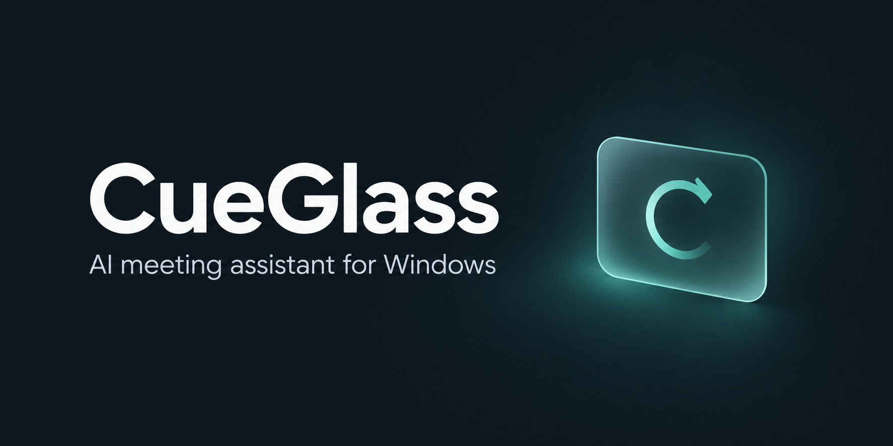
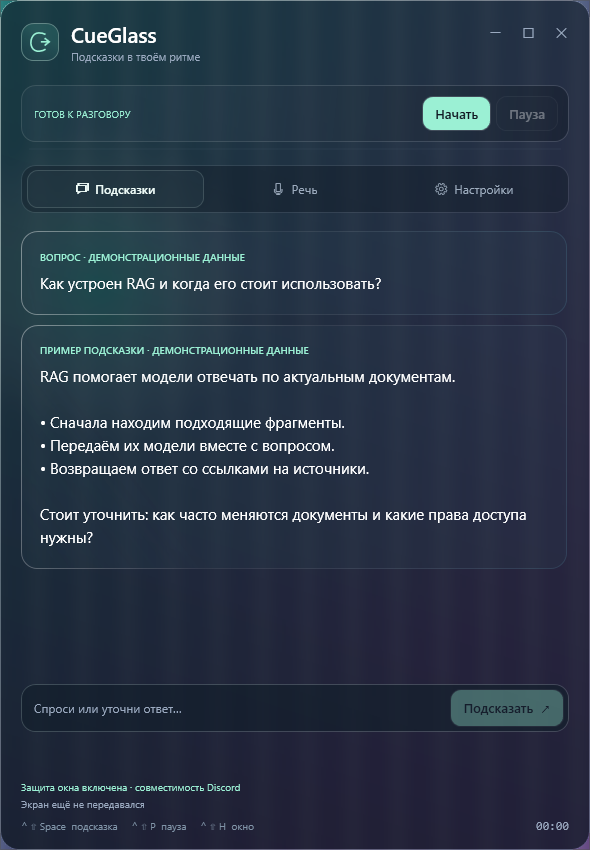

# CueGlass

[English](README.md) · Русский

Нативный помощник для Windows: слушает звук встречи, использует снимки экрана и заметки как контекст и показывает текстовые подсказки в плавающем стеклянном окне.

**Версия 0.1.3 · C# / WPF · OpenAI Realtime · MIT**

## Возможности

- Захват микрофона и звука компьютера через WASAPI.
- Потоковые подсказки после паузы в речи или по горячей клавише.
- Контекст из снимков выбранного монитора, заметок и исходного кода.
- Режим кода для развёрнутых объяснений, исправлений и заготовок приложений.
- Нативное размытие фона, настройка плотности стекла и собственная панель заголовка.
- Исключение окна из захвата средствами Windows и дополнительный режим совместимости с Discord.

Приложение подключается напрямую к OpenAI. Собственного сервера и встроенного браузера нет. Интерфейс и стандартные инструкции для ответов — на русском языке.

## Интерфейс

<p align="center">
  
</p>

На изображении — настоящее окно приложения поверх специально созданного тестового фона. Весь текст в окне демонстрационный.

## Быстрый старт

**Требования:** Windows 10 версии 2004 или новее / Windows 11, x64; интернет; OpenAI API-ключ с подключённой оплатой и доступом к выбранной Realtime-модели. В портативную сборку включён .NET runtime.

1. Распакуй архив и открой `app/CueGlass.exe`. Если скачаны только исходники, сначала [собери приложение](#сборка-из-исходников).
2. Во вкладке **Настройки** вставь API-ключ. При желании включи **Сохранить ключ в Windows**.
3. Выбери микрофон и устройство вывода, через которое слышишь звонок. Наушники помогают избежать дублирования звука.
4. Выбери монитор, при необходимости включи экранный контекст и добавь заметки или исходники.
5. Нажми **Начать**. Выбранный звук и экранный контекст начнут передаваться в OpenAI с оплатой из твоего API-баланса.

В этой версии используется API-ключ; кнопки входа через ChatGPT нет. Это отдельная сессия модели без истории чатов ChatGPT/Codex, памяти, инструментов и доступа к проектам.

## Управление

| Действие | Клавиша / кнопка |
| --- | --- |
| Получить подсказку | `Ctrl+Shift+Space` |
| Приостановить / возобновить передачу | `Ctrl+Shift+P` |
| Скрыть / вернуть окно | `Ctrl+Shift+H` |
| Задать текстовый вопрос | Ввести в нижнем поле и нажать `Enter` |
| Скопировать ответ | Правая кнопка на карточке |
| Завершить сессию | **Завершить** или закрыть приложение |

Скрытие окна оставляет сессию активной. Пауза блокирует новую передачу звука и изображений, но уже отправленные данные отозвать нельзя. Чтобы освободить устройства захвата, заверши сессию. Через 55 минут она останавливается; повторный запуск создаёт новую. Автоматического переподключения и восстановления разговора после обрыва связи нет.

## Звук, экран и работа с кодом

Микрофон и звук компьютера смешиваются в один канал, поэтому достоверного разделения участников нет. Ответы появляются только текстом. Модель получает отдельные снимки экрана, а не непрерывное видео. Неизменившиеся кадры используются повторно; можно включить обновление каждые 15 секунд.

Пауза после речи настраивается от 450 до 1200 мс; по умолчанию — 600 мс. Снимки готовятся во время речи, текст показывается по мере получения. Эти оптимизации сохраняют выбранную модель и не уменьшают глубину рассуждений. Полная задержка зависит от подключения и API.

Для задач по коду перед подключением включи **Код: развёрнутые ответы и исправления** и импортируй нужные текстовые файлы, до 200 КБ каждый. Лимит ответа увеличится с 1200 до 4096 токенов. Добавь ошибку, ожидаемое поведение и необходимый контекст. Для приложения с нуля опиши стек и запрашивай файлы поэтапно.

Файл считывается один раз. После изменений обнови контекст и начни новую сессию. CueGlass предлагает код текстом: он не редактирует проект, не применяет патчи и не запускает тесты.

## Демонстрация экрана

Исключение из захвата включено по умолчанию: используется `WDA_EXCLUDEFROMCAPTURE`, дополнительно доступен флаг совместимости `WCA_EXCLUDED_FROM_DDA`. Строка состояния подтверждает принятие настроек Windows, но не проверяет трансляцию у зрителя.

Для версии 0.1.1 пользователь подтвердил исчезновение чёрного прямоугольника в Discord на Windows 10 сборки 19045. Версия 0.1.3 прошла локальную проверку GDI-захвата с новым стеклянным интерфейсом; это не повторный тест Discord. Результат зависит от Windows и способа захвата в программе демонстрации. Перед использованием проверь изображение на стороне зрителя. CueGlass остаётся обычным процессом Windows.

## Данные и расходы

| Данные | Как обрабатываются |
| --- | --- |
| API-ключ | Передаётся напрямую в OpenAI для авторизации. При сохранении шифруется Windows DPAPI для текущего пользователя. |
| Настройки и импортированный контекст | Хранятся обычным текстом в `%LOCALAPPDATA%\CueGlass\settings.json`. |
| Звук, снимки и расшифровки | При обычном использовании не сохраняются приложением на диск. Включённые источники передаются в OpenAI во время сессии. |
| Аналитика | Собственной аналитики, телеметрии и промежуточного сервера нет. |

Сохранённый ключ находится в `%LOCALAPPDATA%\CueGlass\api-key.dpapi`; удалить его можно в настройках. Расходы API и обработка данных на стороне провайдера определяются условиями твоего аккаунта OpenAI. Счётчик токенов информационный: это не баланс и не расчёт стоимости в деньгах.

## Сборка из исходников

Установи **.NET 8 SDK** в Windows и выполни из корня проекта:

```powershell
.\build.ps1
```

Скрипт восстанавливает зафиксированные зависимости и публикует автономную сборку `win-x64` одним EXE в `app/`. Отдельно устанавливать runtime для запуска этого EXE не нужно. Текущая сборка не подписана сертификатом издателя.

| Путь | Содержимое |
| --- | --- |
| `src/` | Интерфейс WPF, захват звука, Realtime-клиент и локальная диагностика |
| `assets/` | Баннер README и превью для GitHub |
| `verification/` | Отчёты проверок и демонстрационные снимки |
| `licenses/` | Лицензии и уведомления зависимостей |

## Проверки

Локальные синтетические проверки охватывают DPAPI, преобразование аудио, порядок событий WebSocket и потоковый UTF-8, паузу, кэш снимков, жизненный цикл окна, стеклянный эффект и флаги захвата. Результаты: [самопроверка](verification/self-test.json) и [визуальная проверка](verification/visual-check.json).

Эти проверки не используют настоящий OpenAI API-ключ и не записывают реальную встречу. Задержка рабочего API и совместимость с текущей версией Discord ими не проверяются.

## Дизайн и лицензия

Нативный интерфейс WPF использует визуальные подходы [Glass Card](https://21st.dev/@educalvolpz/components/glass-card), [Segmented Tabs](https://21st.dev/@micka_design/components/tabs-base) и темы [Darkmatter](https://21st.dev/community/themes/darkmatter) из 21st.dev. React-компоненты в приложение не встроены.

Баннер создан через ImageGen; [промпт](assets/preview-prompt.txt) включён в проект. Чтобы настроить превью ссылки на репозиторий, загрузи [github-social-preview.jpg](assets/github-social-preview.jpg) в **Settings → Social preview → Edit**, как описано в [инструкции GitHub](https://docs.github.com/en/repositories/managing-your-repositorys-settings-and-features/customizing-your-repository/customizing-your-repositorys-social-media-preview). Баннер внутри README не меняет эту настройку автоматически.

[Лицензия MIT](LICENSE). Уведомления и лицензии зависимостей находятся в [licenses/](licenses/).
